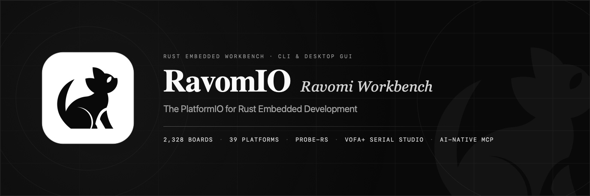
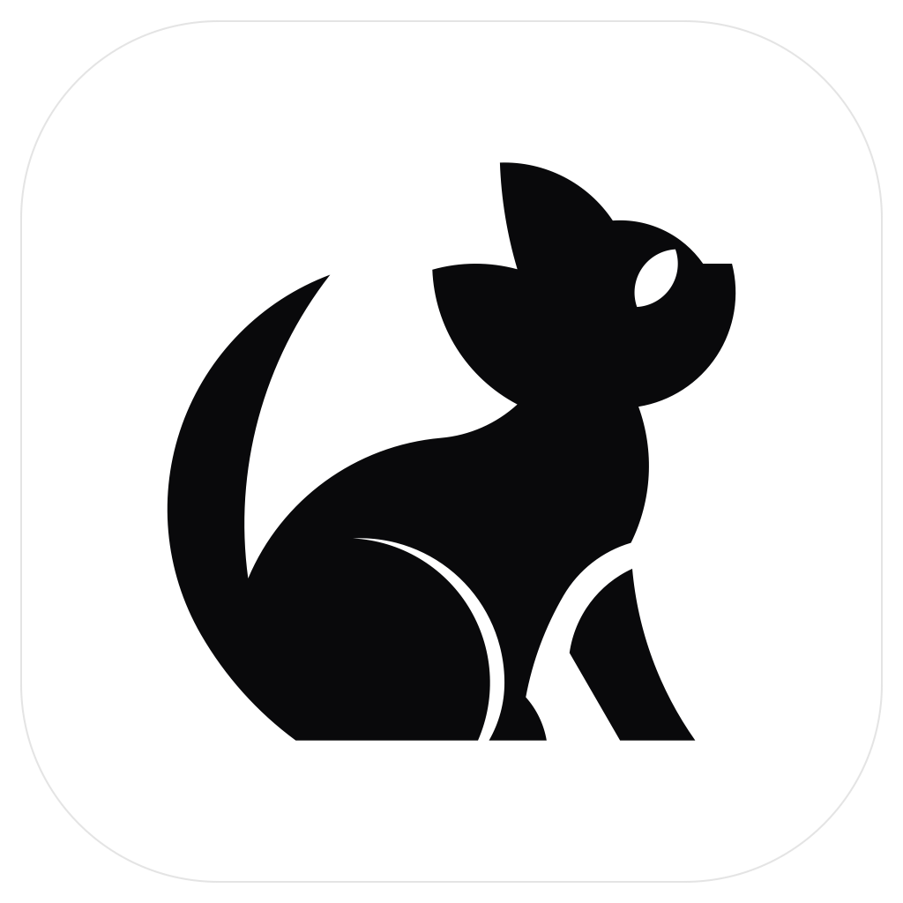
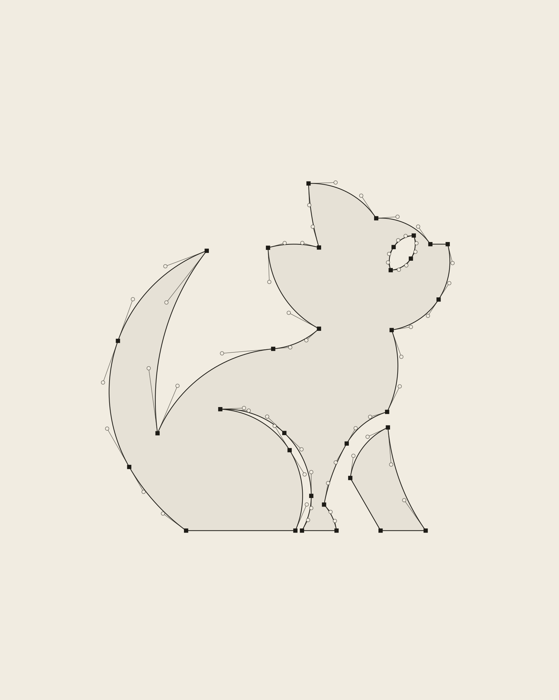

<div align="center">



<br /><br />

**The PlatformIO for Rust Embedded Development**  
Unified board &amp; toolchain management, native `probe-rs` flashing, **VOFA+-style Serial Studio**, **AI-native MCP server**, and the monochrome **Ravomi** desktop workbench.

<p>
  <a href="https://github.com/Ravomi/RavomIO/actions/workflows/ci.yml">
    
  </a>
  <a href="#license">
    
  </a>
  <a href="https://www.rust-lang.org/">
    
  </a>
  <a href="#feature-status">
    
  </a>
  <a href="#ravomi-desktop-workbench">
    
  </a>
  <a href="#ai--mcp-integration">
    
  </a>
</p>

<p>
  <a href="#quick-start">Quick Start</a> ·
  <a href="#ravomi-desktop-workbench">Ravomi GUI</a> ·
  <a href="#ai--mcp-integration">AI &amp; MCP</a> ·
  <a href="#feature-status">Feature Status</a> ·
  <a href="#architecture">Architecture</a> ·
  <a href="#roadmap">Roadmap</a> ·
  <a href="#community">Community</a>
</p>

</div>

---

## Why RavomIO?

Embedded engineering shouldn't be slowed down by fragmented toolchains, brittle vendor IDEs, or manual environment wiring. Inspired by **PlatformIO**, **RavomIO** brings a reproducible, Rust-first workflow to **MCU**, **Embedded Linux SBC**, **Zephyr RTOS**, and **C/C++** targets—through a single CLI (`mio`) and the native **Ravomi** desktop app (`crates/ravom-ui`).

| Pillar | What You Get |
| :--- | :--- |
| **2,328 Built-in Boards** | 39 embedded &amp; Linux SBC platforms compiled into the binary and checked in CI (`1,225` verified `probe-rs` targets), overridable via `~/.ravom/boards` or `$RAVOM_BOARDS_DIR`. |
| **Ravomi Desktop App** | Pure monochrome Black &amp; White (`shadcn/ui` Dark) native `egui` IDE with integrated window chrome, zero-blocking async tasks, and workflow pipeline stepper. |
| **VOFA+ Serial Studio** | Built-in `FireWater`, `JustFloat` (`00 00 80 7F`), and `RawData` protocol engines, 16-channel zoom/pan oscilloscope, hover HUD, CSV export, live gauges, DTR/RTS controls, and persistent command macros/sliders (`~/.ravom/serial_controls.toml`). |
| **Unified Library Hub** | Search and install crates from **`crates.io`** and libraries from **PlatformIO Registry v3**, synced declaratively into `ravom.toml` (`lib_deps`). |
| **Interactive Doctor** | Category-filtered toolchain checker (`cargo`, `rustup`, `probe-rs`, `espflash`, `arm-none-eabi-gcc`, `west`), one-click `brew`/`cargo`/`pip3` installers, persistent `~/.ravom/tools.toml` path overrides, and Rust target management. |
| **AI-Native MCP & Hardening** | Built-in `mio mcp` stdio JSON-RPC 2.0 server with 3 permission tiers, bounded HIL telemetry, clamped PID tuning, and `hil` / `release-hardened` firmware auditing. |

> [!TIP]
> Migrating from an existing PlatformIO project? Run `mio migrate` (or click **Migrate platformio.ini** inside **Ravomi**) to translate `[env]` inheritance, `extends`, and variable interpolation into `ravom.toml`.

---

## Quick Start

```bash
# 1. Search 2,328 built-in boards and verify the embedded registry
mio boards --search stm32f4
mio boards --check

# 2. Initialize a new project (Embassy, RTIC, Zephyr, Arduino, ESP-IDF, or Linux SBC)
mio init --board stm32f401ccu6

# 3. Compile firmware (add --dry-run to preview exact toolchain commands)
mio build

# 4. Flash over SWD/JTAG/USB and attach RTT monitor
mio flash --monitor

# 5. Launch the native Ravomi desktop workbench (or run `cargo run -p ravom-ui --bin Ravomi`)
mio ui

# 6. Start the stdio MCP server for AI agents (--allow-hardware unlocks HIL flashing & PID tuning)
mio mcp --allow-hardware
```

---

## Ravomi Desktop Workbench

Built on pure immediate-mode **egui / eframe** (`crates/ravom-ui`, executable **`Ravomi`**), designed around five focused views:

| View | Key Capabilities |
| :--- | :--- |
| **Workspace** | Empty-folder onboarding (`Init` / `Migrate`), 4-stage build/flash stepper, `ravom.toml` &amp; Zephyr Kconfig / `app.overlay` editors, and instant USB hardware detection. |
| **Libraries** | PlatformIO-inspired dual-source hub querying **`crates.io`** and **PlatformIO Registry v3**, curated embedded driver catalog (displays, sensors, buttons, RTOS), plus installed `lib_deps` management. |
| **Boards** | Master-Detail catalog across 2,328 boards and 39 platforms filtered by ecosystem (**All / Rust / C·C++ / Zephyr / Linux**), inspecting MCU, `rust_target`, RAM/Flash, and `probe-rs` support. |
| **Serial Studio** | VOFA+-inspired multi-view studio (**Split / Oscilloscope / Raw Terminal / Widgets**) with `FireWater` / `JustFloat` / `RawData` decoders, ASCII/HEX TX &amp; loop, DTR/RTS/Reset, 16-ch crosshair oscilloscope, CSV export, and persistent command/slider sidebar. |
| **Doctor** | Clickable Toolchain &amp; Rust Targets configuration center with category chips, automatic installers, native binary path picker saved to `~/.ravom/tools.toml`, and `rustup target add/remove` cards. |

---

## AI & MCP Integration

RavomIO is engineered from the ground up to collaborate safely with AI coding agents (see [AGENTS.md](./AGENTS.md) for the Google Rust Style, MCP, and Skill contract).

### Three-Tier Permission Isolation (`McpMode`)

| Mode | CLI Invocation | Exposed Capabilities |
| :--- | :--- | :--- |
| **`read-only`** | `mio mcp --mode read-only` | `boards_search`, `board_inspect`, `doctor_check`, `device_list`, `plan_build`, `plan_hardened_build`, `audit_firmware`, `plan_chip_protection` |
| **`build`** *(default)* | `mio mcp --mode build` | All `read-only` tools plus `init_project`, `task_start(build)`, `task_poll`, `task_cancel` |
| **`hardware`** | `mio mcp --allow-hardware` | All `build` tools plus `task_start(flash)`, bounded `monitor_sample` (with automatic PID error metrics), and clamped `pid_tune` |

### Stage-Separated Anti-Reversing Hardening

| Profile | Stage | Toolchain &amp; Security Behavior |
| :--- | :--- | :--- |
| **`hil`** | Closed-Loop Tuning | Applies `-C opt-level=s` for deterministic WCET loop timing while keeping symbols and RTT telemetry intact. |
| **`release-hardened`** | Production Release | Applies `-C strip=symbols`, `-C panic=abort`, `--remap-path-prefix`, fat LTO, and optional LLVM obfuscation passes—verified via `audit_firmware` and paired with dry-run `plan_chip_protection`. |

---

## Feature Status

| Area | Status | Notes |
| :--- | :--- | :--- |
| Board registry (`mio boards`) | **Stable** | 2,328 boards / 39 platforms embedded at build time (`1,225` `probe-rs` flashable), overridable via `~/.ravom/boards` |
| `platformio.ini` migration | **Stable** | `[env]` inheritance, `extends`, `${section.option}` / `${this.*}` / `${sysenv.*}` interpolation |
| Rust build (`cargo`) | **Stable** | Cross-compilation (`thumbv*`, `riscv32*`, etc.) + Embedded Linux SBC `std` support |
| **Ravomi** Desktop GUI (`Ravomi`) | **Beta** | Monochrome IDE workbench (`Workspace`, `Libraries`, `Boards`, VOFA+ `Serial Studio`, interactive `Doctor`) |
| VOFA+ Serial Studio &amp; Monitor | **Beta** | Raw-byte `serialport` backend, `FireWater` / `JustFloat` / `RawData`, multi-ch oscilloscope, macros/sliders |
| Zephyr RTOS (`west`, C &amp; Rust) | **Beta** | `mio init --framework zephyr [--lang rust]`, `ravom.toml` Kconfig/DeviceTree/Shields, `west build` |
| `probe-rs` flash / RTT | **Beta** | Command plans unit-tested, chip names validated against `probe-rs`; physical-board runs via `hil/` |
| MCP Server (`mio mcp`) | **Beta** | Stdio JSON-RPC 2.0, 3 permission tiers, async background tasks, bounded HIL telemetry, clamped PID tuning |
| Anti-Reversing &amp; ELF Audit | **Beta** | `dev` / `hil` / `release-hardened` profiles + `audit_firmware` ELF leak scanner + `plan_chip_protection` |
| C/C++ (`arm-none-eabi-gcc`, `avr-gcc`, `esp-idf`) | **Experimental** | Plugin-driven `init -> build` routing and `lib_deps` include wiring |
| Simulators (`Renode` / `QEMU` / `Wokwi`) | **Experimental** | Supported for MCUs with known Renode/QEMU machines |

---

## Architecture

```text
RavomIO/
├── Cargo.toml              # Workspace configuration & Google Rust lints
├── AGENTS.md               # AI agent engineering guide (Google Rust Style, MCP & Skill contract)
├── paseo.json              # Paseo worktree lifecycle hooks & workspace command scripts
├── .worktreeinclude        # Gitignored developer config patterns copied into new worktrees
├── crates/
│   ├── ravom-core/         # Core engine: registry, pkg, toolchain, vofa, security/ELF audit, build/flash/monitor/zephyr
│   ├── ravom-plugin/       # FrameworkPlugin trait, FrameworkKind (Rust / C·C++ / Zephyr) & project scaffolding
│   ├── ravom-cli/          # CLI binary `mio` (subcommands + stdio MCP server + E2E/HIL tests)
│   └── ravom-ui/           # Desktop application `Ravomi` (monochrome egui workbench, Serial Studio, Doctor)
├── boards/                 # 2,328 embedded & Linux SBC board definitions across 39 platforms
├── docs/
│   ├── assets/             # Monochrome brand icons, geometric SVG marks, banner, and poster
│   ├── designs/            # EGM architecture & optimization design documents
│   └── guide/              # Official RavomIO documentation site (submodule)
├── examples/               # Ready-to-build Rust embedded, Zephyr & Linux SBC examples (submodule)
├── hil/                    # Hardware-in-the-loop bench matrix + firmware fixtures
└── scripts/                # Board sync, probe-rs snapshot & Paseo worktree setup/teardown scripts
```

---

## Roadmap

- [x] **Phase 0 — Workspace Bootstrap**: Rust workspace setup with `ravom-core`, `ravom-plugin`, `ravom-cli` (`mio`), and `ravom-ui` (`Ravomi`).
- [x] **Phase 1 — Core & CLI MVP**: End-to-end `mio init` / `build` / `run` / `flash` / `monitor` / `boards` workflow.
- [x] **Phase 2 — Plugin System & Ecosystem**: Unified TOML board registry (39 platforms, 2,328 boards), `ravom-plugin` (`FrameworkKind` + scaffolding), and `mio migrate`.
- [x] **Phase 3 — Ravomi Workbench, VOFA+ Serial Studio & AI MCP**: Monochrome **Ravomi** GUI, PlatformIO/`crates.io` library hub, VOFA+ `FireWater`/`JustFloat` oscilloscope & controls, interactive Doctor, and `mio mcp`.

### Upcoming TODO

- [ ] **Hardware-in-the-Loop Runs**: Continuous physical bench verification (STM32, ESP32, RP2040/RP2350) wired to the HIL runner.
- [ ] **C/C++ Full Core Provisioning**: Automated linker scripts, startup code, Arduino cores, and `esp-idf` bootstrap.
- [ ] **Bootable Rust Templates**: `cortex-m-rt` + auto-generated `memory.x` + `defmt` templates.

---

<details>
<summary><strong>Brand &amp; Geometric Identity (Pure Black &amp; White Monochrome)</strong></summary>

<br />

| App Icon | Bézier Outline Study | Geometric Construction Grid |
| :---: | :---: | :---: |
|  |  |  |

**Official Pure Monochrome Palette**: `#090909` (Canvas Black) · `#121212` (Surface) · `#1A1A1A` (Elevated) · `#2A2A2A` (Hairline Border) · `#FAFAFA` (Primary White) · Vector and raster assets live in [`docs/assets/`](./docs/assets/).

</details>

---

## Acknowledgments

RavomIO stands on the shoulders of the open-source embedded and Rust communities:

- **[PlatformIO](https://github.com/platformio)** &amp; community platform maintainers (**[CommunityGD32Cores/platform-gd32](https://github.com/CommunityGD32Cores/platform-gd32)**, **[Community-PIO-CH32V/platform-ch32v](https://github.com/Community-PIO-CH32V/platform-ch32v)**, **[maxgerhardt/platform-raspberrypi](https://github.com/maxgerhardt/platform-raspberrypi)**)
- **[probe-rs](https://github.com/probe-rs/probe-rs)** — Rust-native MCU flashing, debugging, and RTT logging
- **[egui / eframe](https://github.com/emilk/egui)** — immediate-mode GUI powering **`Ravomi`**
- **[VOFA+](https://www.vofa.plus/)** — inspiration for the `FireWater` / `JustFloat` / `RawData` Serial Studio &amp; live telemetry workflow
- **[mirui](https://github.com/W-Mai/mirui)**, **[Embassy](https://github.com/embassy-rs/embassy)**, **[RTIC](https://github.com/rtic-rs/rtic)**, **[Renode](https://github.com/renode/renode)**, **[QEMU](https://www.qemu.org/)**, and **[Wokwi](https://wokwi.com/)**

---

## Subdirectories &amp; System Boundaries
- `crates`: [./crates/README.md](./crates/README.md) — Workspace crates (`ravom-core`, `ravom-plugin`, `ravom-cli`, `ravom-ui` / `Ravomi`).
- `hil`: [./hil/README.md](./hil/README.md) — Hardware-in-the-loop bench matrix and firmware fixtures (`./hil/fixtures/rtt-hello-stm32f103/README.md`).
- `scripts`: [./scripts/README.md](./scripts/README.md) — PlatformIO board sync, `probe-rs` target snapshot, and Paseo worktree lifecycle scripts.

## Global Invariants
- Board definitions in `boards/` are embedded into `ravom-core` at build time and validated against `crates/ravom-core/data/probe-rs-targets.txt` via `mio boards --check`.
- `ravom-core` and `ravom-plugin` remain UI-agnostic; both `ravom-cli` (`mio`) and `Ravomi` (`ravom-ui`) delegate project, build, flash, and monitor operations to `ravom-core`.

## Global Side Effects
- Reads/writes project manifests (`ravom.toml`, `platformio.ini`), user configs (`~/.ravom/tools.toml`, `~/.ravom/serial_controls.toml`), and build/waveform artifacts on disk.
- Invokes external toolchains (`cargo`, `probe-rs`, `espflash`, `arm-none-eabi-gcc`, `avr-gcc`, `west`, simulators, SSH) and accesses host serial ports.

## System Verification
- Run: `cargo test --workspace`

---

## Community

<div align="center">

**QQ 交流群**: [点击加入【RavomIO交流群】](https://qm.qq.com/q/hZVzfJmAVy)

<br />


</div>

---

## License

Dual-licensed under **MIT** or **Apache-2.0** (matching the Rust ecosystem standard).
