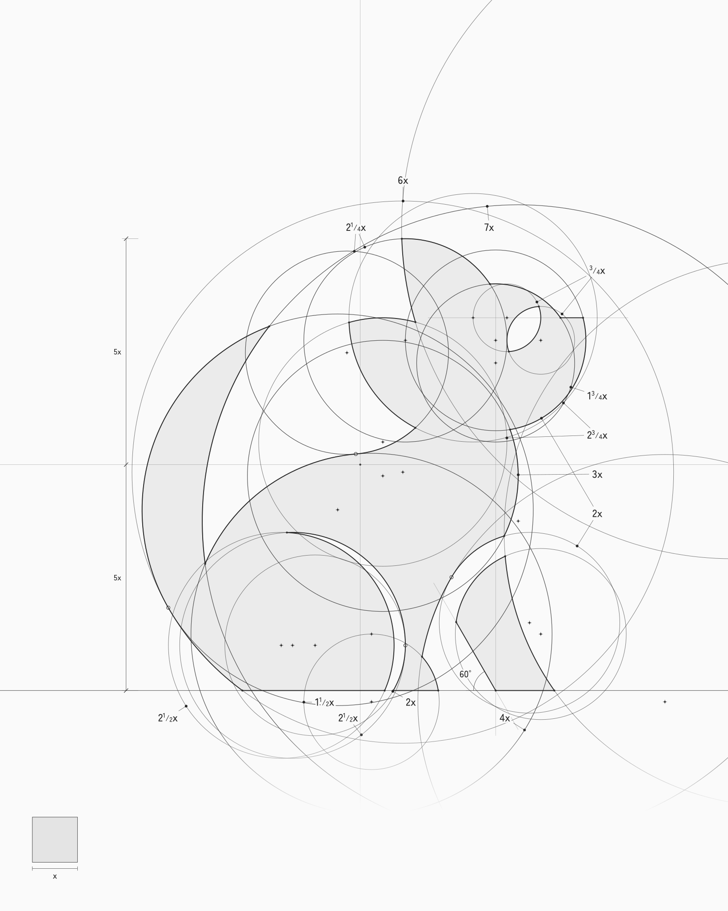

<div align="center">


<br /><br />

**The PlatformIO for Rust Embedded & FPGA Development**  
Unified board & toolchain management, native `probe-rs` flashing, **AI-native MCP server (HIL + PID tuning + anti-reversing)**, and a fast **egui** desktop workbench.

<p>
  <a href="https://github.com/Ravomi/RavomIO/actions/workflows/ci.yml">
    
  </a>
  <a href="#license">
    
  </a>
  <a href="https://www.rust-lang.org/">
    
  </a>
  <a href="#feature-status">
    
  </a>
  <a href="#ai--mcp-integration">
    
  </a>
</p>

<p>
  <a href="#quick-start">Quick Start</a> ·
  <a href="#key-features">Features</a> ·
  <a href="#ai--mcp-integration">AI &amp; MCP</a> ·
  <a href="#feature-status">Feature Status</a> ·
  <a href="#architecture">Architecture</a> ·
  <a href="#roadmap">Roadmap</a> ·
  <a href="#community">Community</a>
</p>

</div>

---

## Why RavomIO?

Embedded development shouldn't be slowed down by fragmented toolchains, brittle vendor IDEs, or manual environment setup. Inspired by **PlatformIO**, **RavomIO** brings a reproducible, Rust-first workflow to **MCU**, **Embedded Linux**, **C/C++**, and **Open-Source FPGA** projects—from a single CLI (`mio`) and a lightweight native desktop workbench (`ravom-ui`).

| Pillar | What You Get |
| :--- | :--- |
| **2,340+ Built-in Boards** | 44 platforms compiled into the binary and validated in CI (`1,225+` verified `probe-rs` targets), overridable via `~/.ravom/boards` or `$RAVOM_BOARDS_DIR`. |
| **Declarative `ravom.toml`** | Define boards, frameworks, flags, and Zephyr Kconfig/overlays in one manifest—with `mio migrate` from `platformio.ini`. |
| **Native `probe-rs` & Serial** | Fast MCU flashing, RTT real-time logging, cross-platform serial monitor, and live waveform plotter. |
| **AI-Native MCP & Security** | Built-in `mio mcp` stdio server with 3 permission tiers, async background builds, bounded HIL/PID tuning, and stage-separated anti-reversing hardening. |
| **Fast `egui` Workbench** | Native desktop GUI (`eframe`) with instant board search, non-blocking build/flash console, and live signal plotting. |

> [!TIP]
> Migrating from an existing PlatformIO repository? Run `mio migrate` to convert `platformio.ini` (including `[env]` inheritance, `extends`, and variable interpolation) into `ravom.toml`, then launch `mio ui` or connect an AI agent via `mio mcp`.

---

## Quick Start

```bash
# 1. Discover boards and validate the embedded registry
mio boards --search stm32f4
mio boards --check

# 2. Initialize a new project (Rust Embassy, RTIC, Zephyr, Arduino, Linux SBC, or FPGA)
mio init --board stm32f401ccu6

# 3. Build firmware (add --dry-run to inspect exact toolchain commands)
mio build

# 4. Flash via probe-rs and attach RTT monitor
mio flash --monitor

# 5. Launch the native egui desktop workbench
mio ui

# 6. Start the stdio MCP server for AI agents (default: build mode; add --allow-hardware for HIL/PID)
mio mcp --allow-hardware
```

---

## AI & MCP Integration

RavomIO is designed from the ground up to work seamlessly with AI coding agents (see [AGENTS.md](./AGENTS.md) for the Google Rust Style, MCP, and Skill contract).

### Three-Tier Permission Isolation (`McpMode`)

| Mode | CLI Invocation | Exposed Capabilities |
| :--- | :--- | :--- |
| **`read-only`** | `mio mcp --mode read-only` | `boards_search`, `board_inspect`, `doctor_check`, `device_list`, `plan_build`, `plan_hardened_build`, `audit_firmware`, `plan_chip_protection` |
| **`build`** *(default)* | `mio mcp --mode build` | All `read-only` tools plus `init_project`, `task_start(build)`, `task_poll`, `task_cancel` |
| **`hardware`** | `mio mcp --allow-hardware` | All `build` tools plus `task_start(flash)`, bounded `monitor_sample` (with automatic PID error metrics), and clamped `pid_tune` |

### Stage-Separated Anti-Reversing Hardening

| Profile | Stage | Toolchain & Security Behavior |
| :--- | :--- | :--- |
| **`hil`** | Closed-Loop Tuning | Applies `-C opt-level=s` for deterministic WCET loop timing while keeping symbols and RTT telemetry intact. |
| **`release-hardened`** | Production Release | Applies `-C strip=symbols`, `-C panic=abort`, `--remap-path-prefix`, fat LTO, and optional LLVM obfuscation passes—verified via `audit_firmware` and paired with dry-run `plan_chip_protection`. |

---

## Key Features

- **Multi-Ecosystem Support**: **Rust** (`cargo`, `embassy`, `rtic`, `embedded-hal`, [`mirui`](https://github.com/W-Mai/mirui) `no_std` embedded UI), **Embedded Linux SBC** (`aarch64`/`armv7` with `rust-lld`), **Zephyr RTOS** (C & Rust via `west`), **C/C++** (`arm-none-eabi-gcc`, `avr-gcc`, `esp-idf`), and **Open-Source FPGA** (`rust-hdl`, `spade`, `veryl`, `verilog` + `yosys` / `openFPGALoader`).
- **Decoupled Core & UI**: Run `ravom-cli` (`mio`) headlessly in CI/CD pipelines and terminals, or launch `ravom-ui` for a full interactive desktop experience.
- **Cross-Platform**: Tested in CI across **Linux**, **macOS**, and **Windows**.

---

## Feature Status

| Area | Status | Notes |
| :--- | :--- | :--- |
| Board registry (`mio boards`) | **Stable** | 2,340+ boards embedded at build time, overridable via `~/.ravom/boards` / `$RAVOM_BOARDS_DIR`, `mio boards --check` validation |
| `platformio.ini` migration | **Stable** | `[env]` inheritance, `extends`, `${section.option}` / `${this.*}` / `${sysenv.*}` interpolation |
| Rust build (`cargo`) | **Stable** | Real cross-compilation covered by tests (`thumbv7m-none-eabi`) + Linux SBC `std` support |
| Zephyr RTOS (`west`, C & Rust) | **Beta** | `mio init --framework zephyr [--lang rust]`, `ravom.toml` Kconfig/DeviceTree/Shields, `west build`, `mio zephyr setup/status/menuconfig` |
| `probe-rs` flash / RTT | **Beta** | Command plans unit-tested, chip names validated against `probe-rs`; physical-board runs via `hil/` |
| Serial monitor | **Beta** | Cross-platform `serialport` backend (Linux / macOS / Windows) |
| MCP Server (`mio mcp`) | **Beta** | Stdio JSON-RPC 2.0, 3 permission tiers, async background tasks, bounded HIL telemetry, clamped PID tuning |
| Anti-Reversing & ELF Audit | **Beta** | `dev` / `hil` / `release-hardened` profiles + `audit_firmware` ELF leak scanner + `plan_chip_protection` |
| C/C++ (`arm-none-eabi-gcc`, `avr-gcc`, `esp-idf`) | **Experimental** | Plugin-driven `init -> build` routing without spurious `Cargo.toml` |
| FPGA (`yosys` → bitstream) | **Experimental** | Synthesis wired; `nextpnr` place-and-route + packing planned |
| Simulators (Renode / QEMU / Wokwi) | **Experimental** | Supported for MCUs with known Renode/QEMU machines |

---

## Architecture

```text
RavomIO/
├── Cargo.toml              # Workspace configuration & Google Rust lints
├── AGENTS.md               # AI agent engineering guide (Google Rust Style, MCP & Skill contract)
├── paseo.json              # Paseo worktree lifecycle hooks & workspace command scripts
├── .worktreeinclude        # Gitignored developer config patterns copied into new worktrees
├── crates/
│   ├── ravom-core/         # Core engine: registry, security/ELF audit, build / flash / monitor / zephyr
│   ├── ravom-plugin/       # FrameworkPlugin trait, FrameworkKind & project scaffolding templates
│   ├── ravom-cli/          # CLI binary `mio` (subcommands + stdio MCP server + E2E/HIL tests)
│   └── ravom-ui/           # Native egui desktop workbench (wine-red theme, panels, tasks, plotter)
├── boards/                 # 2,340+ board definitions (<platform>/<id>.toml), embedded at build time
├── docs/
│   ├── assets/             # Wine-red brand icons, geometric SVG marks, banner, and poster
│   ├── designs/            # EGM architecture & optimization design documents
│   └── guide/              # Official RavomIO documentation site (submodule)
├── examples/               # Ready-to-build Rust embedded, Linux SBC & FPGA examples (submodule)
├── hil/                    # Hardware-in-the-loop bench matrix + firmware fixtures
└── scripts/                # Board sync, probe-rs snapshot & Paseo worktree setup/teardown scripts
```

---

## Roadmap

- [x] **Phase 0 — Workspace Bootstrap**: Rust workspace setup with `ravom-core`, `ravom-plugin`, `ravom-cli` (`mio`), and `ravom-ui` (`egui`).
- [x] **Phase 1 — Core & CLI MVP**: End-to-end `mio init` / `build` / `run` / `flash` / `monitor` / `boards` workflow.
- [x] **Phase 2 — Plugin System & Ecosystem**: Unified TOML board registry (44 platforms, 2,340+ boards), `ravom-plugin` (`FrameworkKind` + scaffolding), and `mio migrate`.
- [x] **Phase 3 — Desktop Workbench & AI-Native MCP**: `ravom-ui` (`egui`) workbench, `mio mcp` (HIL + PID tuning + anti-reversing), and `AGENTS.md`.

### Upcoming TODO

- [ ] **Hardware-in-the-Loop Runs**: Wire a physical bench (STM32, ESP32, RP2040/RP2350, STEP-MXO2-LPC, Tang Nano) to the HIL runner.
- [ ] **C/C++ Build Pipeline**: Linker scripts, startup code, and Arduino core management; `esp-idf` env bootstrap.
- [ ] **FPGA Place & Route**: `nextpnr-{ice40,ecp5,gowin}` + `icepack` / `ecppack` / `gowin_pack`.
- [ ] **Bootable Rust Templates**: `cortex-m-rt` + auto-generated `memory.x` + `defmt` templates.
- [ ] **Toolchain Provisioning**: Automatic download and pinning of `arm-none-eabi-gcc`, `probe-rs`, and `oss-cad-suite` under `.ravom/`.

---

<details>
<summary><strong>Brand &amp; Geometric Logo Kit (Wine-Red Identity)</strong></summary>

<br />

| Official Squircle Icon | Bézier Outline Study | Geometric Construction Grid |
| :---: | :---: | :---: |
|  |  |  |

**Official Wine-Red Palette**: `#941F18` (Primary Claret) · `#821F16` (Bordeaux) · `#5A0C08` (Deep Vintage) · `#12090A` (Velvet Oxblood Base) · Vector assets live in [`docs/assets/`](./docs/assets/).

</details>

---

## Acknowledgments

RavomIO stands on the shoulders of the open-source embedded, FPGA, and Rust communities:

- **[PlatformIO](https://github.com/platformio)** & community platform maintainers (**[CommunityGD32Cores/platform-gd32](https://github.com/CommunityGD32Cores/platform-gd32)**, **[Community-PIO-CH32V/platform-ch32v](https://github.com/Community-PIO-CH32V/platform-ch32v)**, **[maxgerhardt/platform-raspberrypi](https://github.com/maxgerhardt/platform-raspberrypi)**)
- **[probe-rs](https://github.com/probe-rs/probe-rs)** — Rust-native MCU flashing, debugging, and RTT logging
- **[egui / eframe](https://github.com/emilk/egui)** — immediate-mode GUI powering `ravom-ui`
- **[mirui](https://github.com/W-Mai/mirui)**, **[Embassy](https://github.com/embassy-rs/embassy)**, **[RTIC](https://github.com/rtic-rs/rtic)**, **[RustHDL](https://github.com/samitbasu/rust-hdl)**, **[Yosys](https://github.com/YosysHQ/yosys)**, **[nextpnr](https://github.com/YosysHQ/nextpnr)**, **[openFPGALoader](https://github.com/trabucayre/openFPGALoader)**, **[Renode](https://github.com/renode/renode)**, **[QEMU](https://www.qemu.org/)**, and **[Wokwi](https://wokwi.com/)**

---

## Subdirectories & System Boundaries
- `crates`: [./crates/README.md](./crates/README.md) — Workspace crates (`ravom-core`, `ravom-plugin`, `ravom-cli`, `ravom-ui`).
- `hil`: [./hil/README.md](./hil/README.md) — Hardware-in-the-loop bench matrix and firmware fixtures (`./hil/fixtures/rtt-hello-stm32f103/README.md`).
- `scripts`: [./scripts/README.md](./scripts/README.md) — PlatformIO board sync, `probe-rs` target snapshot, and Paseo worktree lifecycle scripts.

## Global Invariants
- Board definitions in `boards/` are embedded into `ravom-core` at build time and validated against `crates/ravom-core/data/probe-rs-targets.txt` via `mio boards --check`.
- `ravom-core` and `ravom-plugin` remain UI-agnostic; both `ravom-cli` (`mio`) and `ravom-ui` delegate project, build, flash, and monitor operations to `ravom-core`.

## Global Side Effects
- Reads/writes project manifests (`ravom.toml`, `platformio.ini`) and build artifacts on disk.
- Invokes external toolchains (`cargo`, `probe-rs`, `openFPGALoader`, `arm-none-eabi-gcc`, `avr-gcc`, `yosys`, simulators, SSH) and accesses host serial ports.

## System Verification
- Run: `cargo test`

---

## Community

<div align="center">

**QQ 交流群**: [点击加入【RavomIO交流群】](https://qm.qq.com/q/hZVzfJmAVy)

<br />


</div>

---

## License

Dual-licensed under **MIT** or **Apache-2.0** (matching the Rust ecosystem standard).
