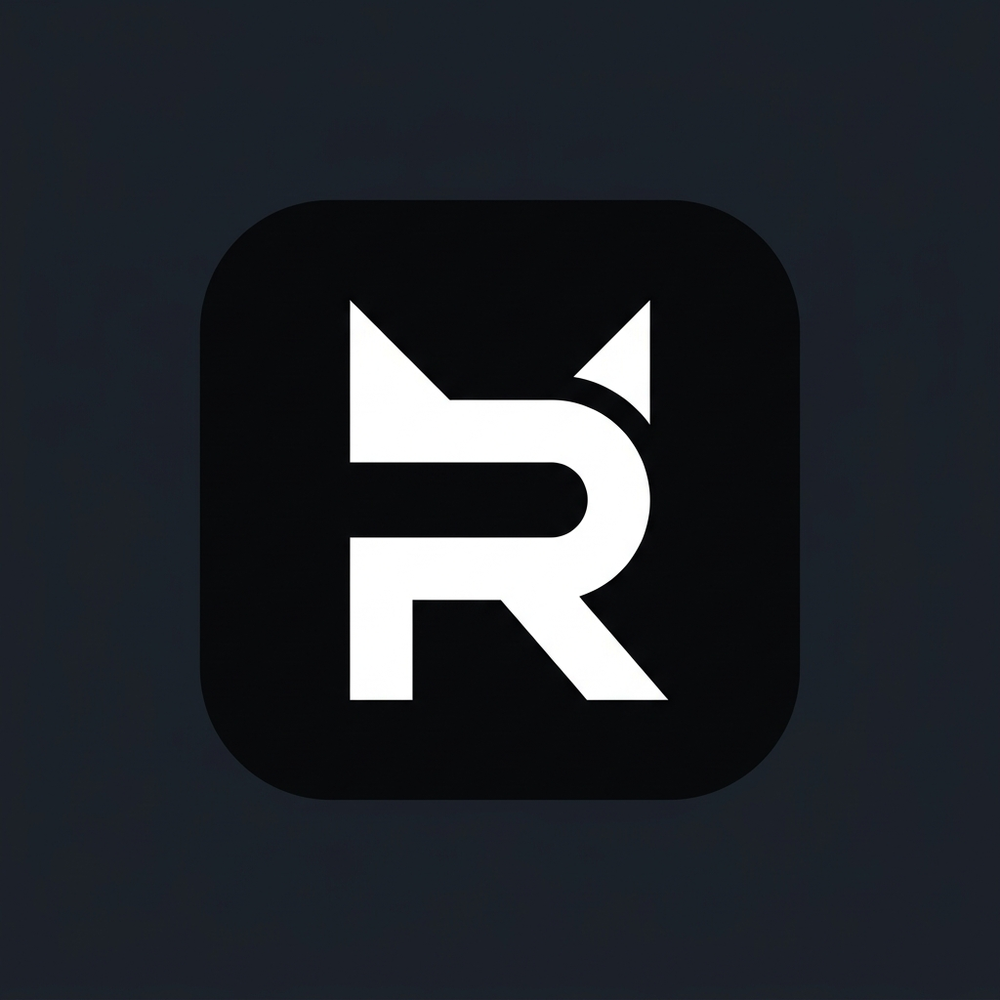

<div align="center">



# RavomIO

**A next-generation, Rust-powered cross-platform ecosystem for embedded & FPGA development.**  
Unified toolchain & board management, native `probe-rs` flashing, **AI-native MCP server (HIL + PID tuning + anti-reversing)**, and an **egui** desktop workbench.

[](https://github.com/Ravomi/RavomIO/actions/workflows/ci.yml)
[](#license)
[](https://www.rust-lang.org/)
[](#feature-status)

</div>

---

## Why RavomIO?

Embedded development shouldn't be slowed down by fragmented toolchains, brittle vendor IDEs, or manual environment setup. Inspired by **PlatformIO**, **RavomIO** brings a modern, reproducible, and fast workflow to both **C/C++** and **Rust** embedded projects—all from a single CLI and a lightweight native desktop workbench.

- **Zero-Hassle Toolchain Management**: Automatically provisions and isolates compilers, SDKs, and debuggers per target board and framework.
- **Declarative Project Configuration**: Define boards, frameworks, build flags, and dependencies cleanly in `ravom.toml` (with smooth migration from `platformio.ini`).
- **Native High-Speed Debug & Flash**: Built-in `probe-rs` integration for ARM Cortex-M, RISC-V, and more—supporting flashing, RTT real-time logging, and hardware debugging out of the box.
- **Fast Native Desktop Workbench**: Powered by **egui** (`eframe`), delivering a responsive project manager, build console, serial/RTT monitor, and real-time waveform plotter.
- **Extensible Plugin System**: Add new silicon platforms, board definitions, build hooks, and custom UI panels through a clean plugin interface.

---

## Key Features

- **Multi-Ecosystem Support**: **Rust** (`cargo`, `embassy`, `rtic`, `embedded-hal`, [`mirui`](https://github.com/W-Mai/mirui) `no_std` embedded UI), **C/C++** (`arm-none-eabi-gcc`, `esp-idf`), and **Open-Source FPGA** (`rust-hdl`, `spade`, `veryl` + `yosys` / `openFPGALoader`) — see the status matrix below for what is production-ready vs. experimental.
- **Board & Registry Compatibility**: 2,342 boards across 44 platforms, embedded into the binary at build time and validated in CI; every `probe_rs_chip` is checked against the real `probe-rs` target database (1,225 boards flashable via `probe-rs`).
- **Decoupled Core & UI**: Run `ravom-cli` (`mio`) headlessly in CI/CD pipelines and terminals, or launch `ravom-ui` for a full interactive desktop experience.
- **Cross-Platform**: Works consistently across Linux, macOS, and Windows.

---

## Feature Status

| Area | Status | Notes |
| --- | --- | --- |
| Board registry (`mio boards`) | Stable | Embedded in the binary (works from any directory), overridable via `~/.ravom/boards` / `$RAVOM_BOARDS_DIR`, `mio boards --check` validation, `<platform>/<id>` for ambiguous ids |
| `platformio.ini` migration | Stable | `[env]` inheritance, `extends`, `${section.option}` / `${this.*}` / `${sysenv.*}` interpolation, unmapped options kept under `extra` with warnings |
| Rust build (`cargo`) | Stable | Real cross-compilation covered by tests (`thumbv7m-none-eabi`) |
| Zephyr RTOS (`west`, C & Rust) | Beta | `mio init --framework zephyr [--lang rust]`, `ravom.toml` Kconfig/DeviceTree/Shields, `west build`, `probe-rs` / `west` flashing, `mio zephyr setup/status/menuconfig` |
| `probe-rs` flash / RTT | Beta | Command plans unit-tested, chip names validated against probe-rs 0.31; physical-board runs via the HIL suite (`hil/`) |
| Serial monitor | Beta | Cross-platform `serialport` backend (Linux / macOS / Windows) |
| MCP Server (`mio mcp`) | Beta | Stdio JSON-RPC 2.0 with 3 permission tiers (`read-only`, `build`, `hardware`), async background tasks, bounded HIL telemetry, and clamped PID tuning |
| Anti-Reversing & ELF Audit | Beta | Stage-separated `hil` vs. `release-hardened` profiles (`-C strip=symbols`, `--remap-path-prefix`, `-C panic=abort`, LLVM obfuscation) + `audit_firmware` ELF leak scanner |
| C/C++ (`arm-none-eabi-gcc`, `avr-gcc`, `esp-idf`) | Experimental | Plugin-driven `init -> build` routing without spurious `Cargo.toml` |
| FPGA (`yosys` → bitstream) | Experimental | Synthesis only; `nextpnr` place-and-route + packing not wired yet |
| Simulators (Renode / QEMU / Wokwi) | Experimental | Only MCUs with a known Renode platform / QEMU machine |
| Plugins | Experimental | Built-in framework templates only; WASM / RPC plugin loading is planned |
| Toolchain provisioning | Partial | `mio doctor` (versions, udev / probe-rs checks) + `--install-target`; no automatic compiler/SDK download yet |

---

## Architecture

```text
RavomIO/
├── Cargo.toml              # Workspace configuration
├── crates/
│   ├── ravom-core/         # Core engine: registry, chip mapping, command plans, build / flash / monitor
│   ├── ravom-plugin/       # Framework plugin trait + built-in templates
│   ├── ravom-cli/          # CLI tool `mio` (src/commands/* per area, tests/ end-to-end + HIL)
│   └── ravom-ui/           # Native egui desktop workbench (app / panels / tasks / console / plotter)
├── boards/                 # Board registry source (<platform>/<id>.toml), embedded at build time
├── hil/                    # Hardware-in-the-loop bench matrix + firmware fixtures
└── scripts/                # probe-rs snapshot + PlatformIO board sync tooling
```

---

## Quick Start

```bash
# List built-in supported boards (and validate the registry)
mio boards
mio boards --check

# Initialize a new project for a target board
mio init --board stm32f401ccu6

# Build firmware (add --dry-run to print the exact toolchain commands)
mio build

# Flash firmware and open RTT monitor
mio flash --monitor

# Launch the desktop workbench
mio ui

# Start the stdio MCP server for AI agents (default: build mode; add --allow-hardware for HIL/PID)
mio mcp --allow-hardware
```

---

## AI & MCP Integration

RavomIO is built to be **AI-agent native** (see [AGENTS.md](./AGENTS.md) for the full Google Rust Style, MCP, and Skill contract):

- **Three-Tier Permission Isolation**: Run `mio mcp --mode read-only` for discovery/audits, `--mode build` (default) for scaffolding and async background builds (`task_start` / `task_poll` / `task_cancel`), or `--allow-hardware` for physical flashing, bounded serial sampling (`monitor_sample`), and clamped PID gain injection (`pid_tune`).
- **Stage-Separated Anti-Reversing**: Tune control loops deterministically with the `hil` profile, then switch to `release-hardened` (`-C strip=symbols`, `-C panic=abort`, `--remap-path-prefix`, fat LTO, optional LLVM obfuscation passes), verify with `audit_firmware`, and generate reversible chip read-protection plans via `plan_chip_protection`.

---

## Roadmap

- [x] **Phase 0 — Workspace Bootstrap**: Rust workspace setup with `ravom-core`, `ravom-plugin`, `ravom-cli` (`mio`), and `ravom-ui` (`egui`).
- [x] **Phase 1 — Core & CLI MVP**: End-to-end `mio init` / `build` / `run` / `flash` / `monitor` / `boards` workflow (verified with STM32F103C8T6 Cortex-M3 ELF build & Google Rust Style lints).
- [x] **Phase 2 — Plugin System & Ecosystem**: Unified TOML board registry (44 platforms, 2,339 boards), `ravom-plugin` framework/RTOS/UI/HDL plugins (Embassy, RTIC, ESP-IDF, FreeRTOS, Zephyr, RT-Thread, `mirui`, `rust-hdl`, `spade`, `veryl`), and `mio migrate` (`platformio.ini` → `ravom.toml`).
- [x] **Phase 3 — Desktop Workbench**: `ravom-ui` (`egui`) with 2,319-board live search, non-blocking background build/flash console, serial port discovery, and real-time signal plotter.

---

## TODO

- [x] **Interactive Serial Terminal**: Cross-platform `serialport` backend for `mio monitor` and port discovery (with USB VID/PID) in `ravom-ui`.
- [x] **Registry Quality Gates**: Embedded registry, `mio boards --check`, probe-rs target snapshot (`scripts/update-probe-rs-targets.sh`), monthly PlatformIO sync PR (`scripts/sync-pio-boards.sh`).
- [x] **HIL Harness**: `hil/boards.toml` bench matrix, RTT marker firmware fixture, `cargo test -p ravom-cli --test hil -- --ignored` + self-hosted `hil.yml` workflow.
- [ ] **Hardware-in-the-Loop Runs**: Wire a bench (STM32, ESP32, RP2040/RP2350, STEP-MXO2-LPC, Tang Nano) to the HIL runner and add one fixture per family.
- [ ] **C/C++ Build Pipeline**: Linker scripts, startup code and Arduino core management for `arm-none-eabi-gcc`; `esp-idf` env bootstrap.
- [ ] **FPGA Place & Route**: `nextpnr-{ice40,ecp5,gowin}` + `icepack` / `ecppack` / `gowin_pack`, per-board device/package/constraints in the registry.
- [ ] **Bootable Rust Templates**: `cortex-m-rt` + generated `memory.x` (from `flash_bytes` / `ram_bytes`) + `defmt` instead of the current minimal `_start` stub.
- [ ] **Toolchain Provisioning**: Download and pin `arm-none-eabi-gcc`, `probe-rs`, `oss-cad-suite` per project (lockfile under `.ravom/`).
- [ ] **Plugin Runtime**: Load out-of-tree plugins (WASM component or JSON-RPC subprocess).

---

## Acknowledgments

RavomIO stands on the shoulders of the open-source embedded, FPGA, and Rust communities. Special thanks to:

- **[PlatformIO](https://github.com/platformio)** & community platform maintainers (**[CommunityGD32Cores/platform-gd32](https://github.com/CommunityGD32Cores/platform-gd32)**, **[Community-PIO-CH32V/platform-ch32v](https://github.com/Community-PIO-CH32V/platform-ch32v)**, **[maxgerhardt/platform-raspberrypi](https://github.com/maxgerhardt/platform-raspberrypi)**) — workflow inspiration and community board metadata.
- **[probe-rs](https://github.com/probe-rs/probe-rs)** — Rust-native MCU flashing, hardware debugging, and RTT logging.
- **[egui / eframe](https://github.com/emilk/egui)** — immediate-mode GUI powering `ravom-ui`.
- **[mirui](https://github.com/W-Mai/mirui)** — `no_std`, ECS-driven embedded & desktop UI framework.
- **[Embassy](https://github.com/embassy-rs/embassy)** & **[RTIC](https://github.com/rtic-rs/rtic)** — modern Rust async and hard real-time embedded frameworks.
- **[RustHDL](https://github.com/samitbasu/rust-hdl)**, **[rust-on-step-mxo2-lpc](https://github.com/y5c4l3/rust-on-step-mxo2-lpc)**, **[Yosys](https://github.com/YosysHQ/yosys)**, **[nextpnr](https://github.com/YosysHQ/nextpnr)**, and **[openFPGALoader](https://github.com/trabucayre/openFPGALoader)** — open-source Rust & Verilog FPGA synthesis and bitstream programming.
- **[Renode](https://github.com/renode/renode)**, **[QEMU](https://www.qemu.org/)**, and **[Wokwi](https://wokwi.com/)** — hardware simulation backends.
- Core Rust crates: **[clap](https://github.com/clap-rs/clap)**, **[serde](https://github.com/serde-rs/serde)**, **[serde_json](https://github.com/serde-rs/json)**, **[toml](https://github.com/toml-rs/toml)**, and **[thiserror](https://github.com/dtolnay/thiserror)**.

---

## Subdirectories & System Boundaries
- `crates`: [./crates/README.md](./crates/README.md) — Workspace crates (`ravom-core`, `ravom-plugin`, `ravom-cli`, `ravom-ui`).
- `hil`: [./hil/README.md](./hil/README.md) — Hardware-in-the-loop bench matrix and firmware fixtures (`./hil/fixtures/rtt-hello-stm32f103/README.md`).
- `scripts`: [./scripts/README.md](./scripts/README.md) — PlatformIO board sync and `probe-rs` target snapshot maintenance scripts.

## Global Invariants
- Board definitions in `boards/` are embedded into `ravom-core` at build time and validated against `crates/ravom-core/data/probe-rs-targets.txt` via `mio boards --check`.
- `ravom-core` and `ravom-plugin` remain UI-agnostic; both `ravom-cli` (`mio`) and `ravom-ui` delegate project, build, flash, and monitor operations to `ravom-core`.

## Global Side Effects
- Reads/writes project manifests (`ravom.toml`, `platformio.ini`) and build artifacts on disk.
- Invokes external toolchains (`cargo`, `probe-rs`, `openFPGALoader`, `arm-none-eabi-gcc`, `yosys`, simulators, SSH) and accesses host serial ports.

## System Verification
- Run: `cargo test`

---

## Community

- **QQ 交流群**: [点击加入【RavomIO交流群】](https://qm.qq.com/q/hZVzfJmAVy)


---

## License

Dual-licensed under **MIT** or **Apache-2.0** (matching the Rust ecosystem standard).
